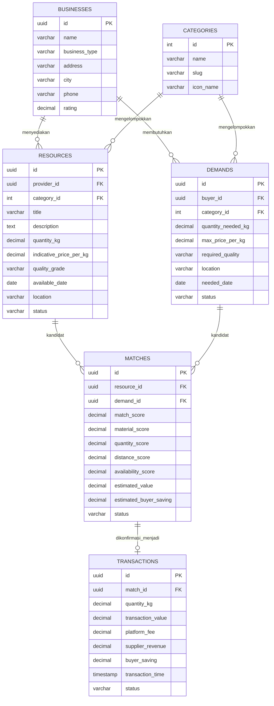

# DOKUMEN 02: SKEMA DATABASE & SEED DATA LENGKAP
## Proyek: ReSource — B2B Resource Matching & Circular Value Platform
**Pilar SDG:** SDG 12 — Responsible Consumption & Production

---

## 1. ARSITEKTUR & ENTITY RELATIONSHIP DIAGRAM (ERD)

ReSource mempertemukan bisnis yang memiliki material kurang termanfaatkan dengan bisnis yang membutuhkannya. Database perlu melacak bisnis, kategori material, penawaran resource, kebutuhan buyer, hasil pencocokan, dan transaksi yang dikonfirmasi.



Relasi utama:
- `businesses`: identitas bisnis penyedia dan/atau pembeli.
- `resources`: material yang ditawarkan supplier.
- `demands`: material yang dibutuhkan buyer.
- `matches`: kandidat kecocokan beserta skor dan estimasi nilai.
- `transactions`: match yang dikonfirmasi. Rekomendasi yang belum dikonfirmasi bukan transaksi berhasil.

---

## 2. DATA DICTIONARY (KAMUS DATA TABEL)

### A. Tabel `businesses` — Profil Bisnis

| Nama Kolom | Tipe Data | Constraint | Keterangan Bisnis |
| :--- | :--- | :--- | :--- |
| `id` | UUID/VARCHAR(36) | PK, Not Null | ID unik bisnis. |
| `name` | VARCHAR(150) | Not Null | Nama bisnis/UMKM. |
| `business_type` | VARCHAR(80) | Not Null | Jenis usaha, misalnya workshop furnitur. |
| `address` | TEXT | Not Null | Alamat atau area usaha. |
| `city` | VARCHAR(100) | Not Null | Kota/kabupaten untuk penyaringan lokasi awal. |
| `phone` | VARCHAR(20) | Nullable | Kontak bisnis untuk tindak lanjut. |
| `rating` | DECIMAL(2,1) | Default 0.0 | Reputasi; pada MVP boleh berupa data simulasi. |

### B. Tabel `categories` — Kategori Material

| Nama Kolom | Tipe Data | Constraint | Keterangan Bisnis |
| :--- | :--- | :--- | :--- |
| `id` | INT | PK | ID kategori. |
| `name` | VARCHAR(80) | Not Null | Nama kategori material. |
| `slug` | VARCHAR(80) | Unique, Not Null | Identifier kategori untuk kode. |
| `icon_name` | VARCHAR(40) | Nullable | Nama ikon UI. |

Contoh kategori awal: Serbuk Kayu, Ampas Kopi, Potongan Kain, dan Potongan Kayu.

### C. Tabel `resources` — Resource yang Ditawarkan

| Nama Kolom | Tipe Data | Constraint | Keterangan Bisnis |
| :--- | :--- | :--- | :--- |
| `id` | UUID/VARCHAR(36) | PK, Not Null | ID listing resource. |
| `provider_id` | UUID/VARCHAR(36) | FK → `businesses.id` | Bisnis penyedia. |
| `category_id` | INT | FK → `categories.id` | Jenis material. |
| `title` | VARCHAR(200) | Not Null | Nama listing material. |
| `description` | TEXT | Nullable | Kondisi dan keterangan penggunaan material. |
| `quantity_kg` | DECIMAL(12,2) | Check >= 0 | Jumlah tersedia dalam kilogram. |
| `indicative_price_per_kg` | DECIMAL(12,2) | Check >= 0 | Harga indikatif per kg, bukan klaim harga pasar. |
| `quality_grade` | VARCHAR(30) | Nullable | Kelas kualitas material; definisinya perlu konsisten per kategori. |
| `available_date` | DATE | Not Null | Tanggal material tersedia. |
| `location` | VARCHAR(150) | Not Null | Lokasi material. |
| `status` | VARCHAR(20) | Default `available` | `available`, `reserved`, `matched`, `inactive`. |

### D. Tabel `demands` — Kebutuhan Buyer

| Nama Kolom | Tipe Data | Constraint | Keterangan Bisnis |
| :--- | :--- | :--- | :--- |
| `id` | UUID/VARCHAR(36) | PK, Not Null | ID kebutuhan. |
| `buyer_id` | UUID/VARCHAR(36) | FK → `businesses.id` | Bisnis yang membutuhkan material. |
| `category_id` | INT | FK → `categories.id` | Jenis material yang dicari. |
| `quantity_needed_kg` | DECIMAL(12,2) | Check > 0 | Jumlah kebutuhan buyer. |
| `max_price_per_kg` | DECIMAL(12,2) | Check >= 0 | Batas harga indikatif buyer. |
| `required_quality` | VARCHAR(30) | Nullable | Kualitas minimum yang dibutuhkan. |
| `location` | VARCHAR(150) | Not Null | Lokasi buyer/tujuan pengiriman. |
| `needed_date` | DATE | Not Null | Tanggal material dibutuhkan. |
| `status` | VARCHAR(20) | Default `open` | `open`, `matched`, `fulfilled`, `cancelled`. |

### E. Tabel `matches` — Hasil Smart Matching

| Nama Kolom | Tipe Data | Constraint | Keterangan Bisnis |
| :--- | :--- | :--- | :--- |
| `id` | UUID/VARCHAR(36) | PK, Not Null | ID hasil pencocokan. |
| `resource_id` | UUID/VARCHAR(36) | FK → `resources.id` | Resource kandidat. |
| `demand_id` | UUID/VARCHAR(36) | FK → `demands.id` | Kebutuhan yang dicocokkan. |
| `match_score` | DECIMAL(5,2) | 0–100 | Skor kecocokan total. |
| `material_score` | DECIMAL(5,2) | 0–100 | Kecocokan jenis material. |
| `quantity_score` | DECIMAL(5,2) | 0–100 | Kecukupan jumlah material. |
| `distance_score` | DECIMAL(5,2) | 0–100 | Skor kedekatan lokasi. |
| `availability_score` | DECIMAL(5,2) | 0–100 | Kesesuaian tanggal tersedia dan tanggal dibutuhkan. |
| `estimated_value` | DECIMAL(12,2) | Default 0 | Estimasi nilai material yang cocok. |
| `estimated_buyer_saving` | DECIMAL(12,2) | Default 0 | Estimasi penghematan berdasarkan harga alternatif asumsi. |
| `status` | VARCHAR(20) | Default `recommended` | `recommended`, `confirmed`, `rejected`, `expired`. |

### F. Tabel `transactions` — Transaksi & Nilai Bisnis

| Nama Kolom | Tipe Data | Constraint | Keterangan Bisnis |
| :--- | :--- | :--- | :--- |
| `id` | UUID/VARCHAR(36) | PK, Not Null | ID transaksi. |
| `match_id` | UUID/VARCHAR(36) | FK, Unique → `matches.id` | Match yang dikonfirmasi. |
| `quantity_kg` | DECIMAL(12,2) | Check > 0 | Jumlah material yang disepakati. |
| `transaction_value` | DECIMAL(12,2) | Check >= 0 | Jumlah × harga per kg. |
| `platform_fee` | DECIMAL(12,2) | Default 0 | Pendapatan layanan ReSource. |
| `supplier_revenue` | DECIMAL(12,2) | Default 0 | Nilai supplier setelah fee pada simulasi ini. |
| `buyer_saving` | DECIMAL(12,2) | Default 0 | Estimasi penghematan buyer. |
| `transaction_time` | TIMESTAMP | Default current timestamp | Waktu konfirmasi. |
| `status` | VARCHAR(20) | Default `pending` | `pending`, `completed`, `cancelled`. |

---

## 3. SQL DDL SCRIPT (POSTGRESQL / SUPABASE)

```sql
CREATE TABLE businesses (
    id VARCHAR(36) PRIMARY KEY,
    name VARCHAR(150) NOT NULL,
    business_type VARCHAR(80) NOT NULL,
    address TEXT NOT NULL,
    city VARCHAR(100) NOT NULL,
    phone VARCHAR(20),
    rating NUMERIC(2,1) NOT NULL DEFAULT 0.0
);

CREATE TABLE categories (
    id INT PRIMARY KEY,
    name VARCHAR(80) NOT NULL,
    slug VARCHAR(80) UNIQUE NOT NULL,
    icon_name VARCHAR(40)
);

CREATE TABLE resources (
    id VARCHAR(36) PRIMARY KEY,
    provider_id VARCHAR(36) NOT NULL REFERENCES businesses(id),
    category_id INT NOT NULL REFERENCES categories(id),
    title VARCHAR(200) NOT NULL,
    description TEXT,
    quantity_kg NUMERIC(12,2) NOT NULL CHECK (quantity_kg >= 0),
    indicative_price_per_kg NUMERIC(12,2) NOT NULL CHECK (indicative_price_per_kg >= 0),
    quality_grade VARCHAR(30),
    available_date DATE NOT NULL,
    location VARCHAR(150) NOT NULL,
    status VARCHAR(20) NOT NULL DEFAULT 'available'
      CHECK (status IN ('available','reserved','matched','inactive'))
);

CREATE TABLE demands (
    id VARCHAR(36) PRIMARY KEY,
    buyer_id VARCHAR(36) NOT NULL REFERENCES businesses(id),
    category_id INT NOT NULL REFERENCES categories(id),
    quantity_needed_kg NUMERIC(12,2) NOT NULL CHECK (quantity_needed_kg > 0),
    max_price_per_kg NUMERIC(12,2) NOT NULL CHECK (max_price_per_kg >= 0),
    required_quality VARCHAR(30),
    location VARCHAR(150) NOT NULL,
    needed_date DATE NOT NULL,
    status VARCHAR(20) NOT NULL DEFAULT 'open'
      CHECK (status IN ('open','matched','fulfilled','cancelled'))
);

CREATE TABLE matches (
    id VARCHAR(36) PRIMARY KEY,
    resource_id VARCHAR(36) NOT NULL REFERENCES resources(id),
    demand_id VARCHAR(36) NOT NULL REFERENCES demands(id),
    match_score NUMERIC(5,2) NOT NULL CHECK (match_score BETWEEN 0 AND 100),
    material_score NUMERIC(5,2) NOT NULL CHECK (material_score BETWEEN 0 AND 100),
    quantity_score NUMERIC(5,2) NOT NULL CHECK (quantity_score BETWEEN 0 AND 100),
    distance_score NUMERIC(5,2) NOT NULL CHECK (distance_score BETWEEN 0 AND 100),
    availability_score NUMERIC(5,2) NOT NULL CHECK (availability_score BETWEEN 0 AND 100),
    estimated_value NUMERIC(12,2) NOT NULL DEFAULT 0,
    estimated_buyer_saving NUMERIC(12,2) NOT NULL DEFAULT 0,
    status VARCHAR(20) NOT NULL DEFAULT 'recommended'
      CHECK (status IN ('recommended','confirmed','rejected','expired')),
    UNIQUE (resource_id, demand_id)
);

CREATE TABLE transactions (
    id VARCHAR(36) PRIMARY KEY,
    match_id VARCHAR(36) UNIQUE NOT NULL REFERENCES matches(id),
    quantity_kg NUMERIC(12,2) NOT NULL CHECK (quantity_kg > 0),
    transaction_value NUMERIC(12,2) NOT NULL CHECK (transaction_value >= 0),
    platform_fee NUMERIC(12,2) NOT NULL DEFAULT 0,
    supplier_revenue NUMERIC(12,2) NOT NULL DEFAULT 0,
    buyer_saving NUMERIC(12,2) NOT NULL DEFAULT 0,
    transaction_time TIMESTAMP NOT NULL DEFAULT CURRENT_TIMESTAMP,
    status VARCHAR(20) NOT NULL DEFAULT 'pending'
      CHECK (status IN ('pending','completed','cancelled'))
);
```

Catatan: ID memakai `VARCHAR(36)` agar mudah disimulasikan di JavaScript. Pada implementasi PostgreSQL produksi, kolom ID dapat menggunakan tipe `UUID`. Skema ini belum mencakup autentikasi, Row Level Security, verifikasi bisnis, atau pembayaran.

---

## 4. JAVASCRIPT LOCALSTORAGE MOCK SCHEMA (UNTUK HACKATHON 4 JAM)

Untuk demo singkat, gunakan mock database JavaScript. Seluruh nama, lokasi, harga, jumlah, dan metrik di bawah merupakan **dummy data**, bukan klaim kondisi pasar.

Simpan sebagai `assets/js/data.js`:

```javascript
const initialData = {
  metrics: {
    totalResourcesMatchedKg: 0,
    totalTransactions: 0,
    estimatedBuyerSavingsIdr: 0,
    platformRevenueIdr: 0
  },

  categories: [
    { id: 1, name: "Serbuk Kayu", slug: "serbuk-kayu", icon: "layers" },
    { id: 2, name: "Ampas Kopi", slug: "ampas-kopi", icon: "coffee" },
    { id: 3, name: "Potongan Kain", slug: "potongan-kain", icon: "scissors" },
    { id: 4, name: "Potongan Kayu", slug: "potongan-kayu", icon: "trees" }
  ],

  businesses: [
    { id: "biz-01", name: "Karya Kayu Workshop", businessType: "Workshop Furnitur", address: "Area Sukoharjo", city: "Sukoharjo", phone: "0812-0000-0001", rating: 4.7 },
    { id: "biz-02", name: "EcoForm Studio", businessType: "UMKM Produk Olahan Kayu", address: "Area Surakarta", city: "Surakarta", phone: "0812-0000-0002", rating: 4.8 },
    { id: "biz-03", name: "Kopi Tengah Kota", businessType: "Coffee Roastery", address: "Area Surakarta", city: "Surakarta", phone: "0812-0000-0003", rating: 4.6 },
    { id: "biz-04", name: "GreenCraft Collective", businessType: "UMKM Produk Ramah Lingkungan", address: "Area Surakarta", city: "Surakarta", phone: "0812-0000-0004", rating: 4.9 }
  ],

  resources: [
    { id: "res-01", providerId: "biz-01", categoryId: 1, title: "Serbuk Kayu Produksi", description: "Serbuk kayu kering dari produksi furnitur.", quantityKg: 500, indicativePricePerKg: 500, qualityGrade: "A", availableDate: "2026-10-15", location: "Sukoharjo", status: "available" },
    { id: "res-02", providerId: "biz-03", categoryId: 2, title: "Ampas Kopi Kering", description: "Ampas kopi kering untuk pemanfaatan non-pangan.", quantityKg: 120, indicativePricePerKg: 2500, qualityGrade: "A", availableDate: "2026-10-15", location: "Surakarta", status: "available" },
    { id: "res-03", providerId: "biz-01", categoryId: 3, title: "Potongan Kain Katun", description: "Potongan kain sisa produksi yang telah dipilah.", quantityKg: 180, indicativePricePerKg: 4500, qualityGrade: "B", availableDate: "2026-10-16", location: "Sukoharjo", status: "available" },
    { id: "res-04", providerId: "biz-01", categoryId: 4, title: "Potongan Kayu Kecil", description: "Potongan kayu untuk kerajinan atau produk kecil.", quantityKg: 220, indicativePricePerKg: 700, qualityGrade: "A", availableDate: "2026-10-15", location: "Sukoharjo", status: "available" }
  ],

  demands: [
    { id: "dem-01", buyerId: "biz-02", categoryId: 1, quantityNeededKg: 300, maxPricePerKg: 650, requiredQuality: "A", location: "Surakarta", neededDate: "2026-10-17", status: "open" },
    { id: "dem-02", buyerId: "biz-04", categoryId: 2, quantityNeededKg: 50, maxPricePerKg: 3000, requiredQuality: "A", location: "Surakarta", neededDate: "2026-10-17", status: "open" }
  ],

  matches: [],
  transactions: []
};

const STORAGE_KEY = "resource-demo-data";

function loadData() {
  const saved = localStorage.getItem(STORAGE_KEY);
  if (saved) {
    try {
      return JSON.parse(saved);
    } catch {
      localStorage.removeItem(STORAGE_KEY);
    }
  }
  localStorage.setItem(STORAGE_KEY, JSON.stringify(initialData));
  return structuredClone(initialData);
}

function saveData(data) {
  localStorage.setItem(STORAGE_KEY, JSON.stringify(data));
}
```

`LocalStorage` cocok untuk demo satu browser saja. Data tidak tersinkron antarperangkat dan tidak aman sebagai penyimpanan transaksi bisnis nyata.

---

## 5. CORE MATCHING LOGIC & KALKULASI NILAI BISNIS

### A. Rumus Match Score

**Match Score = 40% Material Compatibility + 30% Quantity Compatibility + 20% Distance + 10% Availability**

```javascript
function calculateMatchScore(scores) {
  return scores.material * 0.40
    + scores.quantity * 0.30
    + scores.distance * 0.20
    + scores.availability * 0.10;
}
```

Aturan awal MVP:

| Komponen | Aturan contoh |
| :--- | :--- |
| Material | Kategori cocok = 100; tidak cocok = 0. |
| Quantity | `min((resourceKg / demandKg) * 100, 100)`. |
| Distance | 0–5 km = 100; 6–10 km = 90; 11–20 km = 75; 21–30 km = 60; >30 km = 40. |
| Availability | Tersedia pada/sebelum tanggal kebutuhan = 100; setelah tanggal kebutuhan = 0. |

Nama kota saja tidak cukup untuk menghitung jarak akurat. Untuk demo, gunakan jarak simulasi atau kategori jarak. Produk nyata perlu mempertimbangkan ongkos logistik, mutu, volume minimum, dan konsistensi pasokan.

### B. Kalkulasi nilai ekonomi

```javascript
function calculateBusinessValue({
  matchedQuantityKg,
  resourcePricePerKg,
  alternativePricePerKg,
  platformFeeRate = 0.05
}) {
  const transactionValue = matchedQuantityKg * resourcePricePerKg;
  const buyerSaving = Math.max(
    0,
    (alternativePricePerKg - resourcePricePerKg) * matchedQuantityKg
  );
  const platformFee = transactionValue * platformFeeRate;

  return {
    transactionValue,
    buyerSaving,
    platformFee,
    supplierRevenue: transactionValue - platformFee
  };
}
```

- Nilai transaksi = jumlah yang disepakati × harga per kg.
- Estimasi penghematan buyer = selisih harga alternatif dengan harga resource × jumlah.
- Fee ReSource = 5% dari nilai transaksi pada simulasi business model.
- Pendapatan supplier pada contoh = nilai transaksi dikurangi fee platform.

Biaya transportasi, inspeksi mutu, pajak, dan biaya lain belum dihitung. Penghematan di atas adalah estimasi, bukan keuntungan bersih yang dijamin.

### C. Contoh hasil demo

| Metrik | Nilai dummy |
| :--- | :--- |
| Supplier | Karya Kayu Workshop |
| Buyer | EcoForm Studio |
| Resource | Serbuk kayu |
| Stok tersedia | 500 kg |
| Kebutuhan buyer | 300 kg |
| Harga indikatif resource | Rp500/kg |
| Harga alternatif asumsi | Rp650/kg |
| Jumlah yang dicocokkan | 300 kg |
| Estimasi nilai transaksi | Rp150.000 |
| Estimasi penghematan buyer | Rp45.000 |
| Fee ReSource (5%) | Rp7.500 |
| Pendapatan supplier setelah fee | Rp142.500 |

Harga alternatif Rp650/kg adalah asumsi untuk demo, bukan harga pasar yang telah diverifikasi. Pembagian fee juga merupakan asumsi model bisnis yang masih dapat diuji.

---

## 6. HUBUNGAN DATA DENGAN METRIK DAMPAK SDG & PRESENTASI JURI

ReSource dapat melacak dampak melalui:
- **Resource matched (kg):** material yang benar-benar dikonfirmasi dalam transaksi, bukan seluruh stok di katalog.
- **Successful transactions:** jumlah transaksi berstatus `completed`.
- **Estimated buyer savings (IDR):** estimasi penghematan dari transaksi selesai berdasarkan harga pembanding yang tercatat.
- **Platform revenue (IDR):** fee dari transaksi yang memenuhi ketentuan.
- **Resource utilization:** jumlah resource yang dialihkan ke buyer dibandingkan jumlah yang ditawarkan, jika data awal tersedia.

Contoh kalkulasi dashboard:

```javascript
function calculateImpact(transactions) {
  const completed = transactions.filter(tx => tx.status === "completed");

  return {
    totalResourcesMatchedKg: completed.reduce((sum, tx) => sum + tx.quantityKg, 0),
    totalTransactions: completed.length,
    estimatedBuyerSavingsIdr: completed.reduce((sum, tx) => sum + tx.buyerSaving, 0),
    platformRevenueIdr: completed.reduce((sum, tx) => sum + tx.platformFee, 0)
  };
}
```

Saat belum ada transaksi nyata, tampilkan metrik nol atau beri label **simulasi demo**. Jangan mencampurkan data seed dengan klaim dampak nyata.

**Narasi pitching:**

> “ReSource tidak sekadar menampilkan material sisa. Sistem membandingkan jenis material, kecukupan jumlah, kedekatan lokasi, dan ketersediaan untuk merekomendasikan match. Setelah match dikonfirmasi, ReSource memperlihatkan estimasi nilai transaksi, penghematan buyer, pendapatan supplier, dan jumlah material yang kembali masuk ke rantai ekonomi.”

---

## 7. STRATEGI IMPLEMENTASI MVP DALAM 4 JAM

| Waktu | Fokus | Hasil minimum |
| :--- | :--- | :--- |
| 0–30 menit | Setup dan struktur UI | Halaman utama dan navigasi. |
| 30–75 menit | Seed data dan katalog | Kartu resource dari data JavaScript. |
| 75–125 menit | Form kebutuhan buyer | Buyer dapat memilih kategori dan jumlah. |
| 125–180 menit | Matching engine | Skor dan hasil rekomendasi muncul. |
| 180–210 menit | Value & impact dashboard | Nilai transaksi, saving, fee, dan kg matched dihitung. |
| 210–240 menit | Uji alur dan polishing | Demo listing → match → value berjalan. |

Prioritas saat waktu terbatas:
1. Selesaikan satu alur demo end-to-end.
2. Pastikan data seed konsisten dan jelas berlabel dummy.
3. Hitung skor dan nilai bisnis dari data, bukan angka statis.
4. Gunakan LocalStorage jika waktu cukup.
5. Tunda autentikasi, pembayaran, integrasi peta, verifikasi bisnis, dan AI kompleks ke roadmap.

---

## 8. CATATAN VALIDASI SEBELUM PRODUKSI

Dokumen ini adalah rancangan awal untuk prototipe, bukan desain final transaksi komersial. Sebelum digunakan bisnis nyata, validasi standar kualitas per material, harga dan biaya logistik, konsistensi pasokan, volume minimum, proses sengketa/pembatalan, verifikasi bisnis, dan keamanan data.

Jika memakai Supabase, siapkan Row Level Security agar bisnis hanya dapat mengubah data yang berhak dikelolanya. Untuk MVP lomba, batasi kategori dan wilayah. Fokus awal adalah membuktikan alur **Resource → Match → Value**, bukan mencoba menyelesaikan seluruh rantai pasok dalam empat jam.
